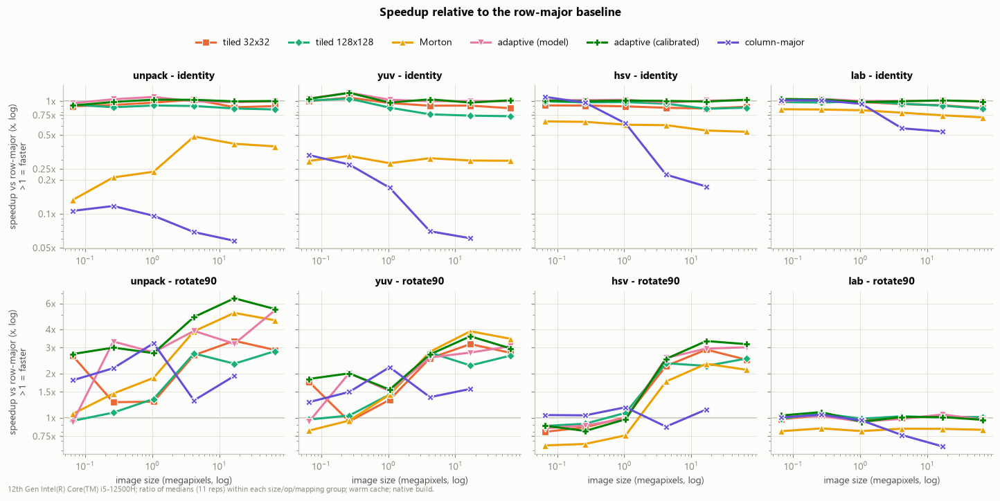
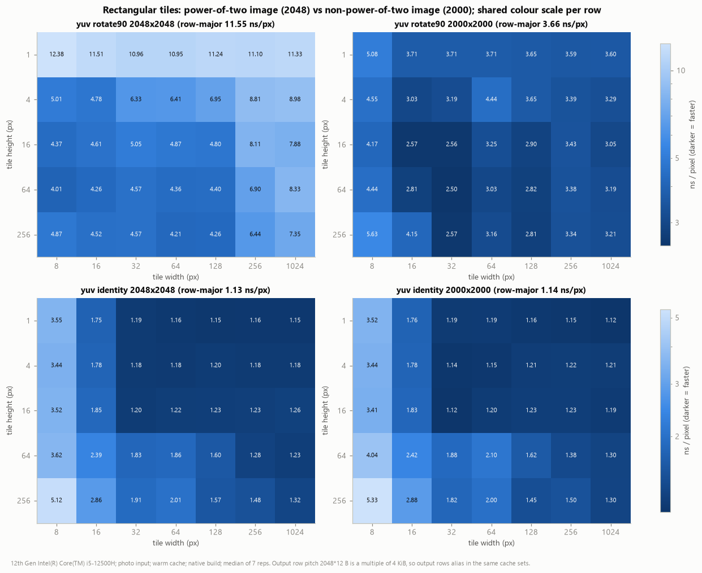
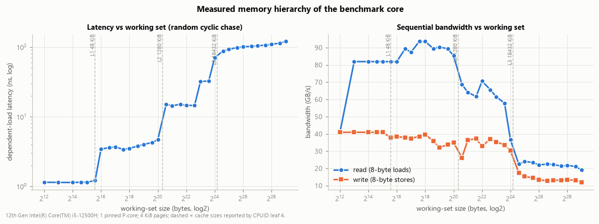

# CacheVision (pixelcache)

**Cache-aware image processing and colour-space benchmarking framework.**
A software-only Computer Organization & Architecture study of how memory
traversal order, spatial tiling, cache capacity and associativity shape the
performance of colour-space conversion (RGB → YUV / HSV / CIELAB).

Three mathematically equivalent traversals (row-major baseline, spatial
tiling, Morton/Z-order) plus a column-major negative control and an
adaptive tile selector all run the *same inlined per-pixel kernel*. Outputs
are bit-identical across strategies (verified), so every timing difference
comes from the order in which memory is touched.

## Key findings

Measured on an Intel Core i5-12500H (one pinned P-core; L1D 48 KiB, L2 1.25 MiB,
L3 18 MiB), GCC 16.2 `-O3 -march=native`, photo input, medians of 7–11 interleaved
repetitions. Full report: [docs/results.md](docs/results.md).

| finding | evidence |
|---|---|
| **Pointwise conversion: row-major is optimal.** All misses are compulsory, so tiling cannot reduce them; it only adds loop and prefetch overhead. | Tiles of 32–512 px are 2–43% slower and 8×8 is 3× slower; Morton is 2.4–3.4× slower (≈5.5 cycles/px just for address generation); column-major is 17× slower at 4096² |
| **Convert + rotate: blocking pays.** The rotated output is written with a one-row stride. | Row-major rotate is 15× slower than plain conversion; tiles recover up to 3.8× and the adaptive selector up to 6.5× (unpack, 4096²) |
| **Associativity matters as much as capacity.** | Rotating 2048² takes 11.55 ns/px vs 3.66 ns/px for 2000²: the 24 576-byte pitch maps every output row to the same L1 set, so the best tile is 8 px wide (12 ways) |
| **The LLC boundary decides cold vs warm.** | Flushing caches costs 2–2.9× while the 15 B/px working set fits in L3 (≤1024²) and nothing beyond it; throughput drops 4.3× past the LLC |
| **Arithmetic intensity decides sensitivity.** | Worst/best traversal at 4096²: unpack 17×, Lab 1.9×; AVX2 gives 2.0× in cache but 1.13× once DRAM-bound |
| **Adaptive tiling is robust, not magic.** | On 36 unseen configurations: 1.00× (identity) and 1.25× (rotate) geomean vs row-major, within 5% of a post-hoc oracle tile in 31/36 |
| **Correct by construction.** | 1250/1250 timed outputs bit-identical across strategies; float64 NumPy and OpenCV validation |

<p align="center">
  <br>
  <br>
  
</p>

Hardware performance counters were not accessible on the measurement machine
(Windows, no PMU driver; WSL2 exposes no PMU), so cache misses are reported from a
clearly labelled trace-driven cache model, never fabricated. `scripts/collect_perf.sh`
collects real counters on Linux.

## Repository layout

```
CMakeLists.txt            two build variants (native = auto-vectorised, scalar = no vectorisation)
include/                  image_types, color_conversion (kernels), traversal (templates),
                          adaptive, benchmark, system_info, cache_sim, mini_json
src/                      implementations: conversions, traversals, adaptive model, harness,
                          CPUID/OS probing, cache simulator, `cachevision` CLI
benchmarks/               run_benchmarks.cpp (cachevision_bench_*), run_cachesim.cpp,
                          benchmark_config.json (all suites)
tests/                    test_conversion, test_traversal, test_correctness (CTest)
scripts/                  run_pipeline.py, prepare_images.py, validate_reference.py,
                          vectorization_report.py, collect_env.py, collect_perf.sh,
                          analyze_results.py, plot_results.py
data/                     generated inputs (not committed) + README
results/raw/              every raw measurement as CSV/JSON
results/tables/, figures/ derived tables and charts
docs/                     architecture.md, methodology.md, results.md (report), presentation.md
```

## Build and run

Requirements: a C++17 compiler (GCC ≥ 9 or Clang ≥ 10 on x86-64), CMake ≥ 3.16,
Ninja (or Make), Python 3 with numpy, pandas, matplotlib, opencv-python, psutil.

```bash
cmake -S . -B build -G Ninja -DCMAKE_BUILD_TYPE=Release
cmake --build build
ctest --test-dir build --output-on-failure
```

```bash
python scripts/run_pipeline.py --clean --skip-build   # images, validation, all suites, model, tables, figures
python scripts/run_pipeline.py --quick --skip-build   # smoke run
```

Single configurations and tools:

```bash
build/cachevision_bench_native --single --op lab --mapping rotate90 --variant tiled:64x64 --size 4096 --image photo
build/cachevision_bench_native --memory --out results/raw
build/cachevision_sim --sizes 512,2048,4096 --out results/raw
build/cachevision convert data/photo_512x512.ppm out.f32 --op lab --strategy adaptive
```

On Linux with `perf`, hardware counters for the timed region only:

```bash
scripts/collect_perf.sh build/cachevision_bench_native results/raw/perf_counters.csv
```

**Windows/MinGW note.** WinLibs GCC fails to link when its install path contains
a space (it passes `default-manifest.o` unquoted to `ld`). Configure through a
space-free directory junction and add the startfile prefix, e.g.
`-DCMAKE_CXX_COMPILER=K:/toolchains/winlibs-gcc16/bin/g++.exe
"-DCMAKE_EXE_LINKER_FLAGS=-BK:/toolchains/winlibs-gcc16/x86_64-w64-mingw32/lib/"`.

## Documentation

* [docs/methodology.md](docs/methodology.md): conventions, timing procedure, metric definitions, adaptive model
* [docs/architecture.md](docs/architecture.md): module structure and design decisions
* [docs/results.md](docs/results.md): the COA report, covering results, analysis, limitations and threats to validity
* [docs/presentation.md](docs/presentation.md): slide deck (Marp markdown)
* [results/summary_tables.md](results/summary_tables.md): every derived table
