# CacheVision: results and COA analysis

**Research question.** How do memory-access and traversal strategies affect
the execution time, cache behaviour, memory traffic and throughput of
colour-space conversion across image sizes?

Every number below comes from `results/raw/` (one benchmark session on
2026-10-27, about 29 minutes of measurements) through
`scripts/analyze_results.py`. The tables are in
[`results/summary_tables.md`](../results/summary_tables.md) and the figures in
`results/figures/`. Definitions of every metric are in
[methodology.md](methodology.md).

## 1. Platform

| | |
|---|---|
| CPU | Intel Core i5-12500H (Alder Lake, hybrid: 4 P-cores with SMT + 8 E-cores, 16 logical CPUs) |
| core used | logical CPU 2: a P-core (OS efficiency class 1), pinned; process HIGH / thread HIGHEST priority |
| caches (CPUID leaf 4, P-core) | L1D 48 KiB, 12-way, 64 sets · L2 1.25 MiB, 10-way, 2048 sets · L3 18 MiB, 12-way, shared · 64-byte lines |
| TLB geometry | unknown: CPUID leaf 0x18 returns zeros under the Hyper-V root partition |
| memory | 16 GB (15.7 GiB visible), 4 KiB pages |
| OS | Windows 11 (10.0 build 26200), AC power, "Balanced" plan |
| compiler | GCC 16.2.0 (WinLibs x86_64, UCRT), `-O3 -march=native -ffp-contract=off`, C++17 |
| clocks | TSC 3.11 GHz (constant). Effective P-core clock from the IMUL probe: 4.42 GHz max, 3.47 GHz median, 2.97 GHz min. It fell from ≈4.4 GHz at the start to ≈3.3–3.7 GHz under sustained load. |
| hardware counters | **unavailable** (no PMU access on Windows without a driver, none in WSL2), so they are reported as `unavailable` |

### 1.1 The memory hierarchy, measured

| region | dependent-load latency | sequential read | sequential write |
|---|---|---|---|
| L1 (≤ 24 KiB) | 1.14 ns (≈ 5 cycles at 4.4 GHz) | 82 GB/s | 41 GB/s |
| L2 (96 KiB … 640 KiB) | 3.63 ns (≈ 16 cycles) | 90 GB/s | 38 GB/s |
| L3 (2.5 MiB … 9 MiB) | 14.8 ns (≈ 65 cycles) | 64 GB/s | 36 GB/s |
| DRAM (≥ 72 MiB) | 108 ns (≈ 470 cycles) | 21.6 GB/s | 13.1 GB/s |

The latency curve steps up exactly at the CPUID capacities: 48 KiB, 1.25 MiB
and 18 MiB. A DRAM access costs about 95× an L1 hit. There is one extra
step *inside* L3, from ≈15 ns to ≈32 ns between 4 MiB and 8 MiB. It is
consistent with exceeding the reach of the second-level TLB with 4 KiB pages,
but that cannot be verified here because the TLB geometry is masked. Every
result below should be read against this table. The workload's working set
is 15 B/px (3 B in + 12 B out), so it fits in L2 up to about 290×290, in L3
up to about 1120×1120, and goes to DRAM beyond that.

## 2. Correctness first (independent of speed)

* **1250 / 1250** timed configurations produced output **bit-identical** to
  the row-major baseline (64-bit hash of the whole output). That covers
  every strategy, tile, size, op, mapping and both build variants.
* All CTest suites pass for both build variants. They check every pixel
  visited exactly once for 15 shapes × 9 tile shapes and 6 sub-regions,
  Morton order and monotonicity on rectangles, rotation bijectivity,
  bit-identity across strategies, rejection of empty and invalid input, and
  the cache-model sanity checks.
* Against an independent float64 NumPy implementation of the documented
  formulas, the maximum absolute errors over four test images are: unpack
  7.4e-8, YUV 1.7e-7, HSV 2.4e-4 ° (hue) and 8.9e-8 (S, V), Lab 9.6e-5. All
  84 judged checks pass, with tolerances derived from float32 error
  propagation.
* Against OpenCV 4.12 `cvtColor`, YUV agrees to 2.4e-7 (same coefficients)
  and HSV to 1.8e-3 ° / 3.0e-5. The HSV difference is exactly the bound
  255·FLT_EPSILON implied by OpenCV's `+FLT_EPSILON` in the denominators.
  OpenCV's float Lab differs by up to 0.18 L\* and 0.43 a\*. Re-deriving it
  with OpenCV's own constants does not remove the gap, and on the grey axis
  the error is a sawtooth with a period of about 128 input codes. That is
  the signature of OpenCV's table/interpolation-based evaluation, so this
  gap is **reported, not judged** ([validation_summary.md](../results/validation/validation_summary.md)).

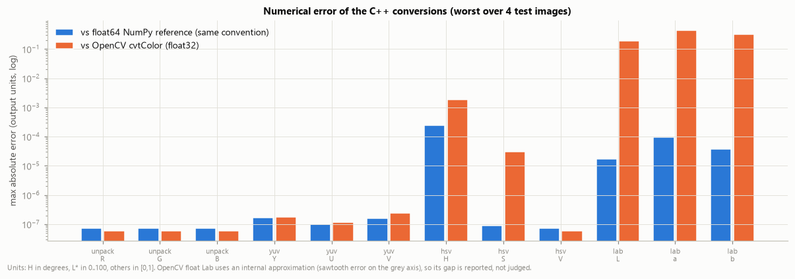

## 3. Pure colour conversion (identity mapping)

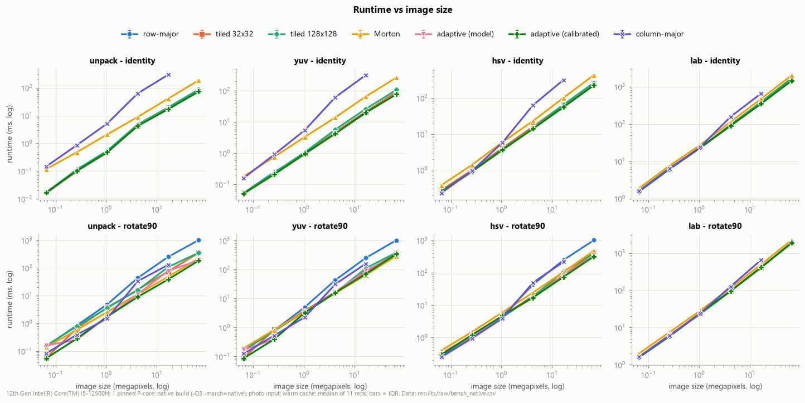

Row-major ns/px and the other strategies relative to it, at the in-cache
(512²) and DRAM-bound (4096²) sizes. Ratios above 1 are faster than row-major.

| op | row-major 512² | row-major 4096² | tiled 32² @4096² | tiled 128² @4096² | Morton @4096² | column-major @4096² |
|---|---|---|---|---|---|---|
| unpack | 0.38 ns | 1.01 ns (3.8 cyc) | 0.88× | 0.86× | 0.42× | **0.058×** |
| YUV | 0.95 ns | 1.17 ns (3.9 cyc) | 0.91× | 0.74× | 0.30× | 0.061× |
| HSV | 3.47 ns | 3.30 ns (12.4 cyc) | 0.86× | 0.85× | 0.55× | 0.17× |
| Lab | 24.3 ns | 21.1 ns (79.6 cyc) | 0.92× | 0.91× | 0.75× | 0.54× |

(cyc = estimated core cycles per pixel = ns/px × probed clock.)

**Row-major is the right order for a pointwise conversion.** It is the
fastest strategy, or within the ±5% run-to-run noise of the fastest, in
every identity configuration of the main suite. The adaptive selector
independently arrives at the same answer (§7).

Why, in COA terms:

* **Spatial locality and cache-line utilisation.** Row-major walks both
  buffers at unit stride. Every byte of every 64-byte line it fetches is
  used before the line is evicted: 64/3 ≈ 21 input pixels and 64/12 ≈ 5.3
  output pixels per line. The cache model shows the consequence. Row-major
  incurs exactly the compulsory **15/64 = 0.234** misses per pixel at every
  level.
* **No temporal reuse to exploit.** A pointwise conversion touches each
  input byte once and writes each output byte once. Tiling cannot reduce
  misses that are all compulsory, and the model confirms that every square
  tile also stays at ≈0.234 misses/px.
* **But tiles cost time anyway.** Measured, square tiles of 32–512 px are
  2–43% slower than row-major at ≥2048² (YUV), and 8×8 tiles are 3× slower
  everywhere (tile sweep: 0.30–0.34×). The extra cost cannot be misses (the model says they are
  equal). It comes from (a) inner loops only `tw` pixels long, which wastes
  the 32-pixel AVX2 vectorised loop and its epilogues
  ([vectorization_report.md](../results/vectorization_report.md)); (b) loop
  and address overhead (`index_only`: 0.27 ns/px row-major, 0.47 for 8×8);
  and (c) **hardware prefetching**. Each tile row is a separate short stream
  (96 B of input for a 32-wide tile) that jumps by a row pitch, so the L2
  streamer never ramps up the way it does on one long sequential stream.
* **Column-major is the negative control.** Its stride is one row (W·3
  bytes in, W·12 out), so each pixel touches two new lines and uses 3/64
  and 12/64 of them. The model shows 2.16 L1 misses/px (9.2× compulsory),
  and from 2048² on, 2.16 misses/px in L2 as well. Measured: 17 ns/px
  (65 cycles) for unpack at 4096², **17× slower** than row-major.
  The penalty *grows with image size*. For HSV at 256², column-major is as
  fast as row-major (in fact 9% faster), because the whole 0.98 MB working
  set sits in L2 and stride no longer matters.

**Compute-bound kernels hide memory behaviour.** Lab needs ≈80 cycles per
pixel (three `cbrtf` calls), so even column-major costs only 1.9× at 4096².
The out-of-order core overlaps the miss latency with independent arithmetic
from neighbouring pixels (memory-level parallelism). Traversal order matters
in proportion to arithmetic intensity: unpack (3 multiplies per 27 B of
traffic) is the most sensitive, Lab the least.

### 3.1 Throughput falls off the LLC cliff

Row-major unpack runs at 0.24 ns/px at 256² (L2-resident), 0.47 ns/px at
1024² (15 MiB, L3-resident) and 1.03 ns/px from 2048² on (60 MiB → DRAM).
That is a 4.3× drop as the working set leaves the caches. At 4096² the
compulsory-traffic model (27 B/px including write-allocate reads) gives
**≈26.8 GB/s**, the same order as the single-core streaming bandwidth
measured in §1.1. So the memory-bound kernels are **bandwidth-bound**, not
compute-bound, once the image exceeds the LLC.

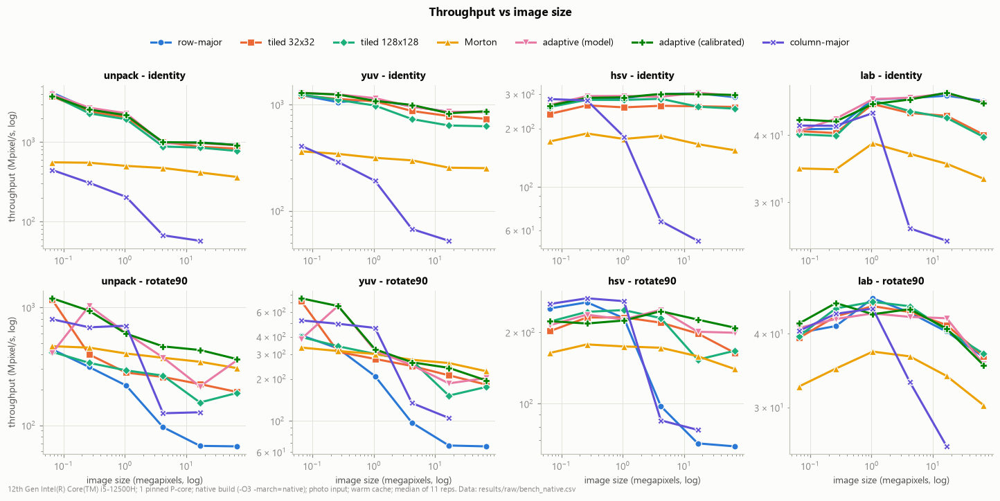

### 3.2 Warm vs flushed caches: the working-set boundary

| unpack, row-major | 256² | 512² | 1024² | 2048² | 4096² |
|---|---|---|---|---|---|
| flushed / warm time | 2.85 | 1.99 | 2.28 | 1.02 | 0.97 |
| working set | 0.98 MB | 3.9 MB | 15.7 MB | 63 MB | 252 MB |

Flushing every line (CLFLUSH) before each run makes small images 2–2.9×
slower, but has **no effect once the working set exceeds the 18 MiB L3**.
Beyond that point the "warm" run is cold anyway, because each run evicts
its own data. YUV behaves the same way with smaller ratios (1.16–1.19 →
0.96–1.02). Lab is insensitive (0.94–1.01) because compute dominates.
Morton is insensitive (0.90–1.08) because its time is dominated by address
generation (§5).

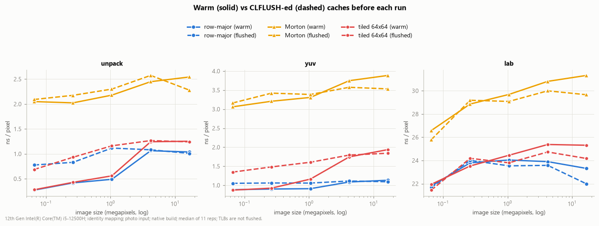

## 4. Convert + rotate: where blocking pays

With the output rotated by 90°, a sequential input stream writes the output
**column by column**, one pixel every H·12 bytes. This is the transpose
pattern, the classic case for cache blocking.

| rotate90 @4096², ns/px | row-major | column-major | tiled 32² | tiled 128² | Morton | adaptive (calib.) |
|---|---|---|---|---|---|---|
| unpack | 14.9 (55.7 cyc) | 7.74 | 4.47 | 6.39 | 2.89 | **2.30 (6.5×)** |
| YUV | 15.0 | 9.51 | 4.72 | 6.59 | **3.85 (3.9×)** | 4.17 (3.6×) |
| HSV | 14.7 | 12.9 | 5.05 | 6.52 | 6.30 | **4.41 (3.3×)** |
| Lab | 24.8 | 38.8 | 24.2 | 24.7 | 29.5 | 24.5 (1.01×) |

(Full per-size tables: `results/tables/main_rotate90_*.md`. At 2048² and
4096² the calibrated selector chose 8-pixel-wide tiles (8×8 … 8×128) for
unpack, YUV and HSV, and plain row-major order for Lab.)

* Row-major rotate is **14.8× slower** than row-major identity for unpack
  at 4096², with the same arithmetic and the same bytes moved. The model
  shows why: 1.17 misses/px at L1, L2 *and* L3, and 75 B/px of DRAM read
  traffic instead of 15. Every 12-byte output write lands on a different line, and
  that line is evicted before the next 12 bytes arrive one input row later.
* Tiling restores locality. Inside a tile, the `th` rows of a tile column
  write `th × 12` contiguous bytes of each output row, so lines are filled
  completely while they are still cached. The best tiles reach **3.3–3.8×
  (tile sweep, YUV)** and up to **6.5× (adaptive, unpack)**.
* For Lab the gain is ≤ 1.09× at every size. The 80 cycles of arithmetic per
  pixel absorb the stalls (§3).

### 4.1 Power-of-two images: cache-set aliasing

The most striking result of the study is in the tile-shape suite (YUV,
rotate90):

| | 2000×2000 | 2048×2048 |
|---|---|---|
| row-major | **3.66 ns/px** | **11.55 ns/px** (3.2× slower for 4.9 % more pixels) |
| best tile | 32×64 → 2.50 ns/px (1.47×) | 8×64 → 4.01 ns/px (2.88×) |
| widths ≥ 256 | 3.2–3.6 ns/px | 6.4–9.0 ns/px |

At 2048 the output row pitch is 2048 × 12 = 24 576 B = 384 cache lines,
and 384 mod 64 = 0. **Every output row starts in the same L1 set**, so the
lines being filled for different output rows compete for only 12 ways. In
L2, gcd(384, 2048) = 128, so they reach only 16 of 2048 sets, which is 160
lines. A tile wider than about 12 pixels thrashes L1, which is why the best
tile at 2048 is **8 pixels wide**. At 2000 the pitch is 24 000 B = 375
lines, an odd number (gcd(375, 64) = 1), so successive output rows spread
over all sets, and 16–128-wide tiles work well. The cache model reproduces this exactly
(rotate row-major: 1.17 L2 misses/px at 2048² vs 0.234 at 2000²). It is a
pure **associativity / conflict-miss** effect: capacity is identical.

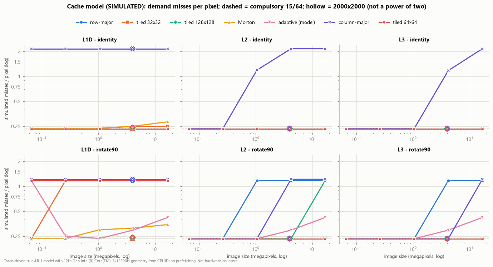

### 4.2 Tile size depends on image size, mapping and op

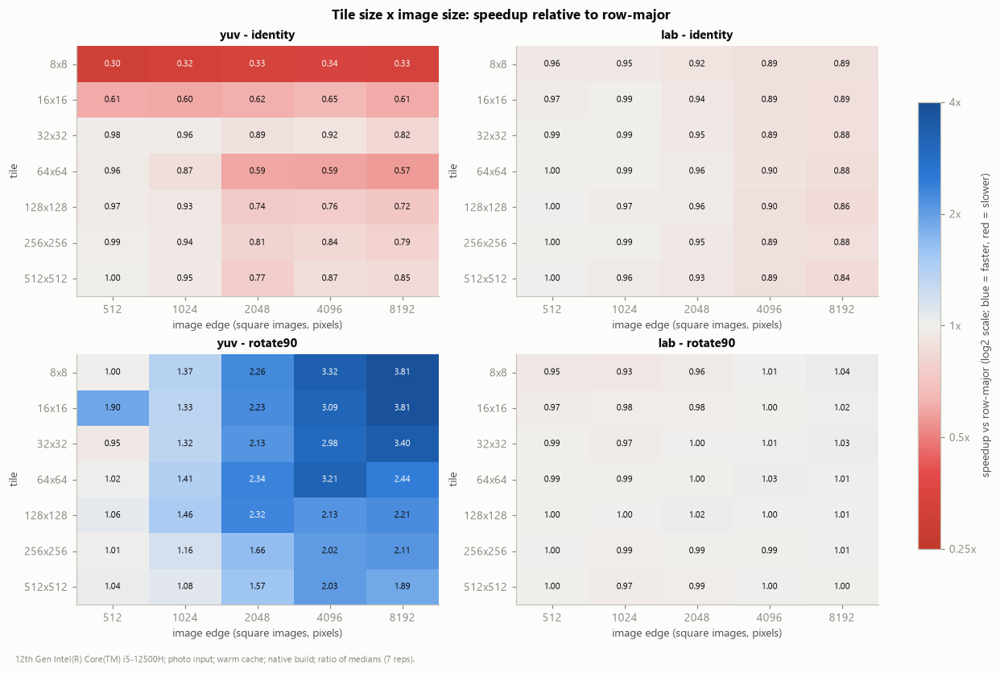

* Identity: every tile is ≤ 1.0× and 8×8 is the worst (≈0.3×). The best
  "tile" is no tile.
* Rotate, YUV: the best square tile moves from 16×16 at 512² (1.90×) to
  128² at 1024², 64² at 2048², 8² at 4096² (3.32×) and 16² at 8192² (3.81×).
  There is no single best tile.
* Lab: 0.84–1.04× everywhere. Tile choice is irrelevant when compute-bound.

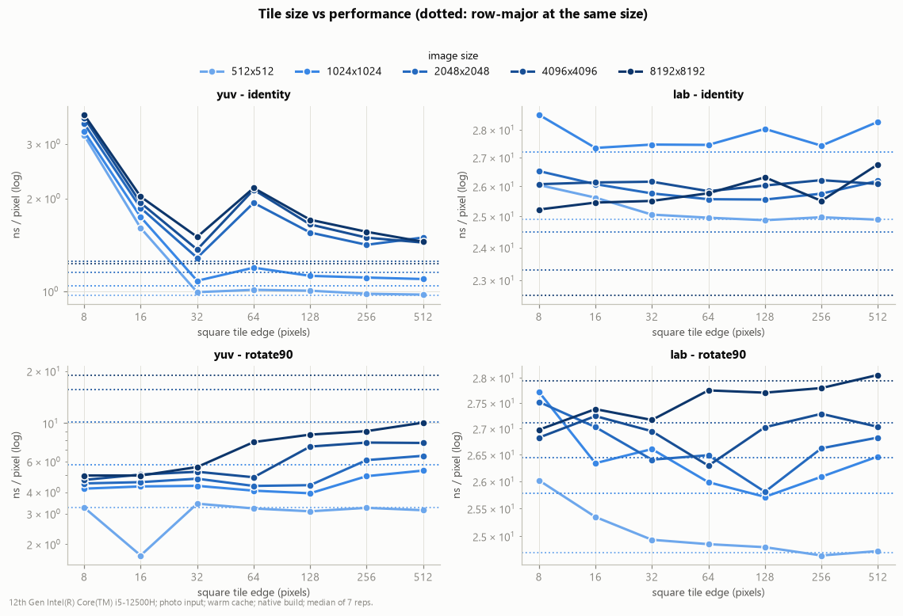

## 5. Morton / Z-order: good locality, expensive addresses

| index_only (ns/px, address generation only) | 1024² | 4096² |
|---|---|---|
| row-major | 0.270 | 0.269 (≈1.0 cycle) |
| tiled 32² / 128² | 0.306 / 0.346 | 0.313 / 0.348 |
| tiled 8² | 0.445 | 0.466 |
| column-major | 0.456 | 0.464 |
| **Morton** | **1.416** | **1.475 (≈5.5 cycles)** |

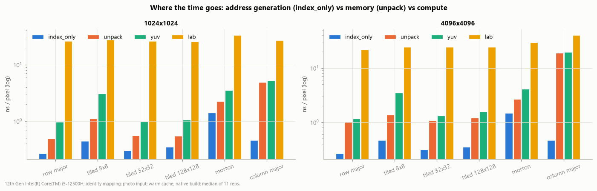

* **Locality is fine.** The model puts Morton's misses within 8–48% of
  compulsory (identity 4096²: 0.284 L1 misses/px vs 0.234), because Z-order
  keeps successive pixels inside small square blocks at every scale.
* **Indexing is not.** Bit de-interleaving (PEXT), the per-pixel
  `y·pitch + 3x` address computation, and the out-of-range skip logic cost
  ≈5.5 cycles per pixel before any data is touched. That is 5.5× row-major.
  The per-pixel loop also cannot be vectorised.
* As a result, for identity Morton is **2.4× (unpack) to 3.4× (YUV) slower**
  at 4096² and 1.3× slower for Lab. It never wins a pointwise conversion.
* For rotate it is a robust, **tuning-free** improvement on power-of-two
  sizes: 3.9× for YUV and 5.2× for unpack at 4096², the best YUV result at
  2048²–8192². Z-order is *cache-oblivious*: it needs no tile size, so it
  sidesteps the aliasing problem of §4.1. On the non-power-of-two "unseen"
  sizes, where row-major is not pathological, its geometric-mean speedup is
  only 0.86×. The address-generation cost outweighs the locality gain.

## 6. Other effects

**Image content (2048², ns/px).** Memory traffic is content-independent;
time is not.

| | gradient | photo | mixed | noise |
|---|---|---|---|---|
| HSV, row-major | 2.75 | 3.63 | 4.37 | **13.26** |
| Lab, row-major | 29.4 | 22.4 | 29.5 | **42.6** |
| YUV, row-major | 1.09 | 1.09 | 1.10 | 1.10 |

HSV picks a branch per pixel (which channel is the maximum). On random noise
that branch is unpredictable, and the mispredictions cost **3.7× vs the
photo**. YUV is branch-free and identical on every image. Lab also varies
(22–43 ns/px), consistent with data-dependent paths in `lab_f` and in the
libm `cbrtf`; we did not isolate which. Benchmarks that use only synthetic
noise would overstate HSV cost by about 4×.

**Auto-vectorisation (native vs scalar build, same flags otherwise).**

| scalar time / vectorised time | 1024² | 4096² |
|---|---|---|
| YUV, row-major, identity | 2.03 | 1.75 |
| unpack, row-major, identity | 1.86 | **1.13** |
| YUV, tiled 64², identity | 1.71 | 1.11 |
| Morton, any op | 0.89–1.01 | 0.89–1.00 |
| rotate90, any strategy | 0.90–1.08 | 0.92–1.00 |
| HSV, Lab | 0.94–0.99 | 0.94–1.00 |

AVX2 helps only where GCC vectorises the loop: the unit-stride inner loops
of row-major and tiled identity for unpack and YUV. For unpack the gain
collapses from 1.86× to 1.13× once the image is DRAM-bound. A faster core
does not help a bandwidth-bound loop (the roofline argument). Lab and HSV
call or branch per pixel and are not vectorised, and in those cases the
scalar build was 1–6% faster, a code-layout effect within the noise band.

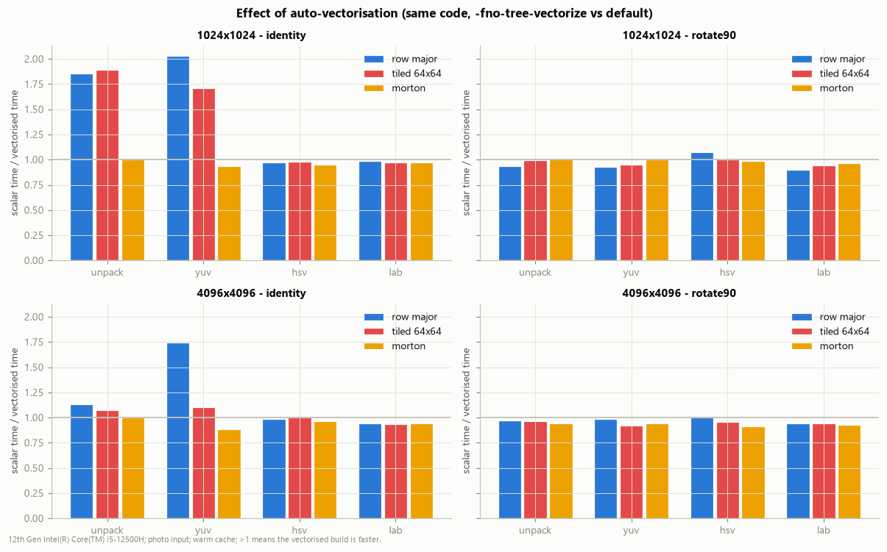

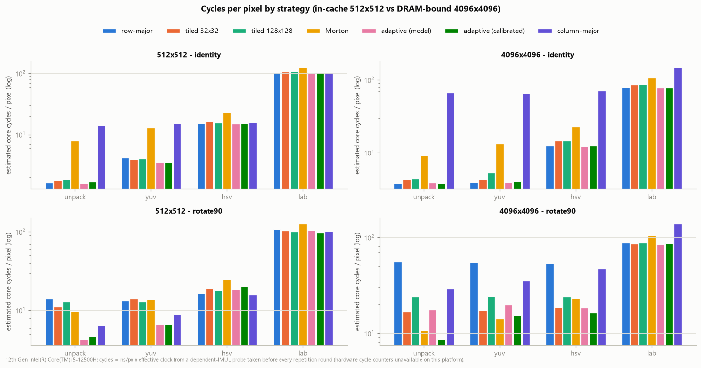

## 7. Adaptive tiling (research extension)

The selector (methodology §5) ranks ≈80 candidate tiles with an analytical
line-transfer model. It uses only the image geometry, stream directions and
CPUID cache size, associativity and sets; its weights were fixed before any
benchmark. `adaptive_calib` additionally times the model's top four plus the
full-width tile on a ≈1-Mpixel band of the real image. It was evaluated on
six image sizes **never used during development** (1000², 1920×1080,
2500×1700, 3840×2160, 5000×3000, 7680×4320) × 3 ops × 2 mappings = 36
configurations.

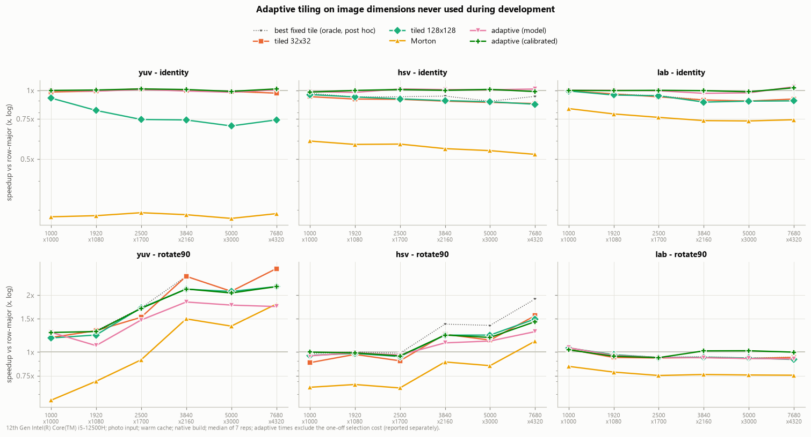

Geometric-mean speedup vs row-major on the unseen sizes:

| | identity (18) | rotate90 (18) |
|---|---|---|
| **adaptive (calibrated)** | **1.00×** | **1.25×** |
| adaptive (model only) | 1.00× | 1.15× |
| best fixed square tile, chosen post hoc (oracle) | 0.95× | 1.30× |
| tiled 8² / 16² / 32² / 64² / 128² / 256² | 0.66 / 0.80 / 0.94 / 0.79 / 0.87 / 0.89 | 1.05 / 1.21 / 1.23 / 1.19 / 1.23 / 1.13 |
| Morton | 0.50× | 0.86× |

* **Identity:** the model recognises that both streams are contiguous along
  x and picks full-width tiles, i.e. row-major order. It therefore matches
  row-major (1.00×) and is faster than even the post-hoc best fixed tile in
  17 of 18 configurations (the exception is 0.2% slower; geomean
  adaptive/oracle time ratio 0.954). The useful outcome is "do not tile",
  reached without hard-coding it.
* **Rotate:** calibrated adaptive is within 5% of the post-hoc best tile in
  13 of 18 configurations, 4.3% slower than that oracle on geometric mean,
  and slightly better than the best *fixed* choice (32² or 128², 1.23×). The
  model alone is within 5% in 10 of 18 (12.6% slower than the oracle).
  Calibration adds 16–166 ms (YUV), 55–220 ms (HSV) or 0.38–1.1 s (Lab),
  which pays for itself after **1.3–7 frames** for rotated YUV images of
  2500×1700 and larger, but never for identity, where there is nothing to
  gain.
* **Where it misses:** rotated HSV at ≥ 3840×2160, where the best tile
  (8×8) is 1.14–1.32× faster than the adaptive choice. The model ranks
  narrow tiles low on non-aliasing sizes, so 8-wide tiles never reach the
  calibration set. Widening the calibrated candidate set to cover more tile
  widths is the obvious fix. It is not applied here, because changing the
  rule after seeing the unseen-size results would invalidate the evaluation.

**Verdict.** Adaptive tiling does **not** beat a well-chosen fixed tile by a
meaningful margin. Its value is robustness: it never loses noticeably to
row-major, it avoids the 3× penalty of a bad tile, it handles power-of-two
aliasing automatically (at 2048/4096 it chooses 8-wide tiles; at
non-power-of-two sizes it chooses 128–256-wide ones), and it needs no
per-machine hand-tuning. The cost model alone ranks strategies sensibly.
Calibration is what makes it competitive with the oracle.

## 8. How well does the cache model explain the measurements?

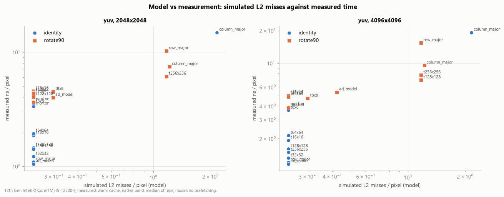

Spearman rank correlation across strategies between simulated L2
misses/pixel and measured ns/pixel (YUV) is 0.46–0.68 for identity at
1024²–4096² (L1 or L2 misses) and **0.68 (2048²) / 0.84 (4096²)** (L2) for
rotate. The model explains *which
strategy suffers conflict and capacity misses*. It does not explain the
costs that are not misses: address generation (Morton), short-loop and
vectorisation effects (small tiles), and prefetching. With no prefetcher
modelled, the simulator charges row-major the same compulsory misses as
every tile, while the real streamer hides most of them for row-major. That
gap is itself evidence of what the hardware prefetcher contributes.

## 9. COA concepts and where they were observed

| concept | where it shows up in the data |
|---|---|
| memory hierarchy (registers → L1 → L2 → L3 → DRAM) | measured latency plateaus 1.1 / 3.6 / 14.8 / 108 ns at the CPUID capacities (§1.1) |
| spatial locality | row-major uses every byte of each line; column-major uses 3/64 of each input line and is 17× slower (§3) |
| temporal locality | absent in pointwise conversion (all misses compulsory), so tiling cannot help identity (§3); present in rotate, where an output line is revisited `th` rows later (§4) |
| cache lines and utilisation | compulsory 15/64 = 0.234 misses/px in the model; rotate row-major uses 12 of 64 bytes per line visit (1.17 misses/px) |
| capacity and working set | the warm/flushed difference disappears at the 18 MiB LLC boundary (§3.2); throughput drops 4.3× between L3-resident and DRAM-resident images (§3.1) |
| associativity / conflict misses | 2048-wide rotate is 3.2× slower than 2000-wide; the best tile width follows sets × ways (§4.1) |
| cycles and instructions per pixel | ≈1 cycle of address generation for row-major vs ≈5.5 for Morton; 3.8 cycles/px unpack to 80 cycles/px Lab (instruction counts unavailable without PMU) |
| memory bandwidth and data movement | ≈26.8 GB/s compulsory traffic at 4096² unpack, near the single-core streaming limit; 75 B/px vs 15 B/px of DRAM traffic for rotate without and with blocking (model) |
| miss rates | simulated per level and defined as misses / demand accesses (`results/tables/cachesim.md`) |
| row-major layout and stride | identity vs column-major vs rotate: the same bytes, different strides, 1×–17× time |
| hardware prefetching | short tile rows and Morton break the streams the prefetcher follows; model misses are equal while measured time differs (§3, §8) |
| compute vs locality trade-off | Morton: better locality for rotate but 5.5× address cost; Lab hides almost all memory effects (§3, §5) |
| SIMD and the roofline | vectorisation gains 1.9–2.0× in cache but 1.1× once bandwidth-bound (§6) |
| branch prediction | HSV on noise is 3.7× slower than on a photo with identical memory traffic (§6) |

## 10. Hypotheses: verdicts

| hypothesis | verdict |
|---|---|
| H1: sequential row-major traversal benefits from spatial locality and predictable access | **Supported.** Fastest or within noise for every pointwise configuration; column-major is 3–17× slower once the image leaves L2; flush and size effects behave as the hierarchy predicts. |
| H2: tiling improves cache reuse for large images | **Rejected for pure conversion** (no reuse: tiles are 0–70% slower, 8×8 3× slower). **Supported for convert + rotate** (2.3–6.5× at ≥ 2048² for memory-bound ops), with the best tile depending on associativity and image pitch. |
| H3: Morton improves locality but adds indexing overhead and less predictable access | **Both halves confirmed.** Misses are near compulsory, but ≈5.5 cycles/px of address generation and no vectorisation make it 2–3.4× slower for conversion. It is a tuning-free win only for rotate on power-of-two sizes. |
| H4: the best strategy and tile vary with dimensions, architecture and operation | **Supported.** Best tile: none (identity), 8–128 (rotate, depending on size and aliasing), irrelevant (Lab). 2048 vs 2000 changes the best tile width 4× and the row-major time 3.2×. |

## 11. Limitations and threats to validity

* **No hardware counters.** Cache-miss, LLC and DRAM figures come from a
  model (no prefetching, true LRU, modulo set index on *virtual* addresses,
  no TLB). L1 is virtually indexed with a 4 KiB set span, so the L1 conflict
  analysis holds. L2/L3 are physically indexed and the L3 uses a slice hash,
  so physical page placement can change their conflict behaviour.
  `scripts/collect_perf.sh` is provided for a Linux host with `perf`, but it
  was not run here.
* **Frequency drift.** On a laptop under the Balanced plan, the P-core
  clock fell from ≈4.4 GHz to ≈3.3–3.7 GHz during the session (probe range
  2.97–4.42 GHz). Shuffled interleaving puts all strategies of a group
  under the same conditions, but absolute ns/px from different suites are
  not strictly comparable. The main suite ran first, during the decay, and
  has the highest median coefficient of variation (6.8%; other suites
  2.3–4.0%). "Cycles" are estimates from a pre-round probe, not cycle
  counts.
* **Noise.** Median CV is 2.3–6.8% per suite and the 90th percentile
  6–17%. Differences under about 5% are reported as ties. Background
  processes (browser, Defender at about 6% of one CPU, this tooling) shared
  the L3 and memory bus. Thermal throttling cannot be read without
  elevation.
* **One machine, one core type.** Alder Lake P-core cache geometry, an
  18 MiB L3 and Windows 4 KiB pages. E-cores, other vendors, huge pages, or
  a different associativity would move every crossover. In particular, the
  power-of-two aliasing result depends on sets × ways.
* **"Flushed" is not cold.** CLFLUSH evicts data lines but not TLBs,
  page-walk caches or the 1 KiB Lab table.
* **Layout choices.** Interleaved RGB888 → interleaved float32 makes the
  output stream four times larger than the input. Planar or uint8 outputs
  would change the balance between streams and the absolute numbers.
* **Compiler-specific.** GCC 16 vectorisation decisions (see the report).
  Clang or MSVC may vectorise different loops. Strategies are only compared
  within one build.
* **Adaptive evaluation.** The model's weights were chosen a priori, but its
  associativity term was added during development, after reasoning about
  4096-wide rotation and before the unseen sizes were run. The DTLB size
  (64 entries) is an assumption. The oracle is post hoc.
* **Inputs.** "photo" sizes above 512 are mirror tiles of a 512² crop: real
  local statistics, but repeated content. Lab and HSV timing depends on
  content (§6).
* **Linux code path.** It is written but was not compiled or run in this
  environment; only the Windows build was tested.

## 12. Conclusions

1. For a **pointwise colour conversion**, plain row-major order is optimal on
   this machine. There is no temporal reuse, all misses are compulsory, and
   row-major gives the hardware prefetcher and the vectoriser the longest,
   simplest streams. Tiling and Morton only add overhead, up to 3× (8×8
   tiles) and 2.4–3.4× (Morton) for memory-bound conversions.
2. As soon as the conversion is fused with a **layout change** (rotation),
   the strided output stream makes row-major 15× slower than the plain
   conversion. Blocking recovers 2.3–6.5×, and Z-order recovers 3.9–5.2× on
   power-of-two sizes.
3. **Associativity matters as much as capacity.** Power-of-two row pitches
   alias into a few cache sets. The best tile width at 2048 is set by L1
   ways (8 px), not by cache size.
4. **Arithmetic intensity decides sensitivity.** Lab (≈80 cycles/px) is
   almost indifferent to traversal order, while unpack (≈4 cycles/px) varies
   17×.
5. A **model-guided, briefly calibrated tile selector** never loses
   noticeably to row-major, avoids pathological tiles, adapts to aliasing,
   and lands within 5% of a post-hoc oracle in 31 of 36 unseen
   configurations. It does not beat a well-chosen fixed tile by a
   meaningful margin.
